<!-- Dante: a sentence on part count, print time, and why you documented it would make this page. -->

An articulated model of the Wasp from *ARC Raiders* that I designed and 3D printed, along with the instructions I created so it can be printed and assembled by someone else: part organization, print orientation, and step-by-step assembly.

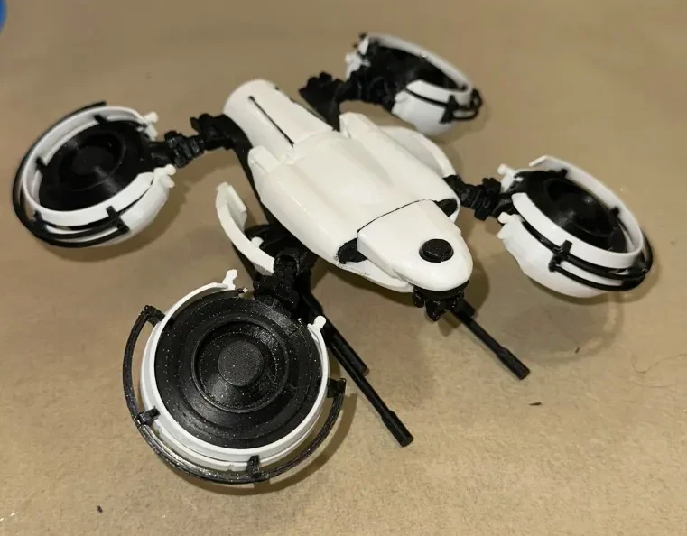

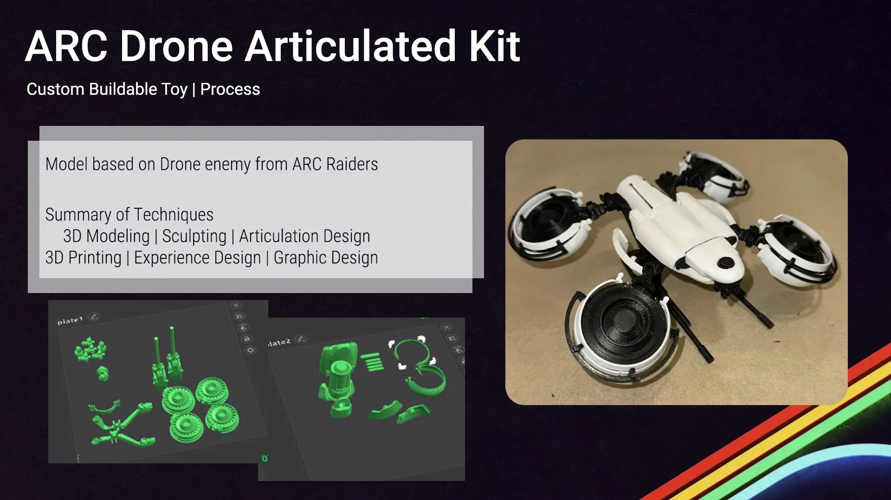

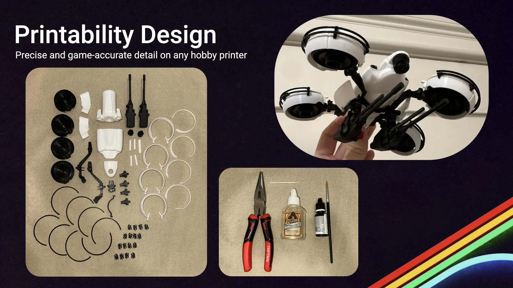

## Assembly guide

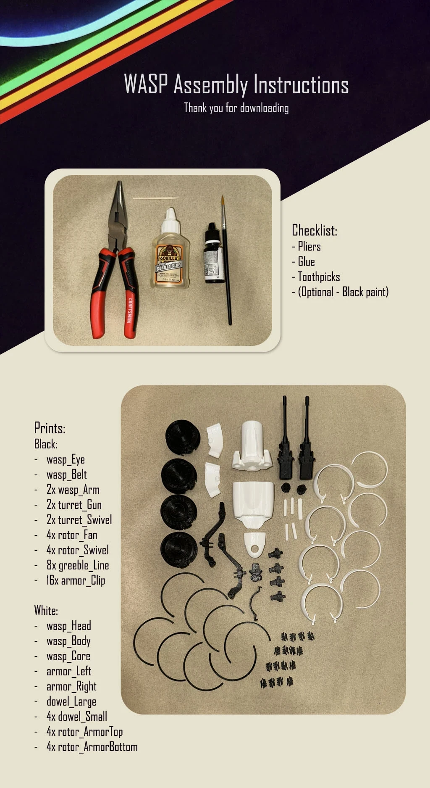 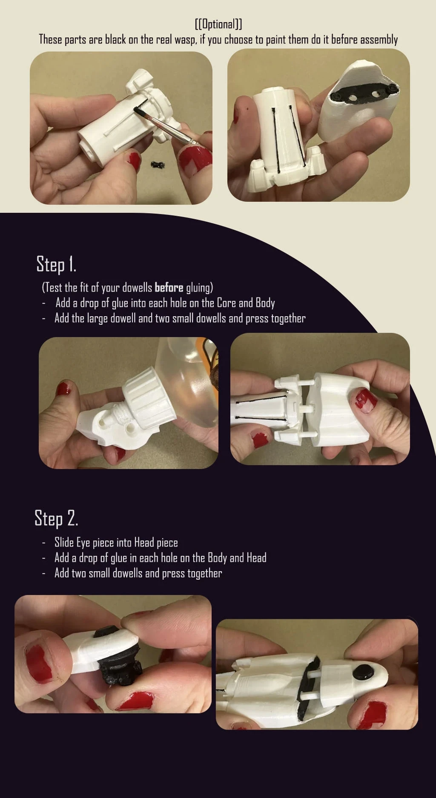

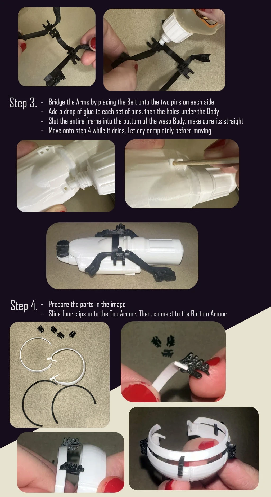 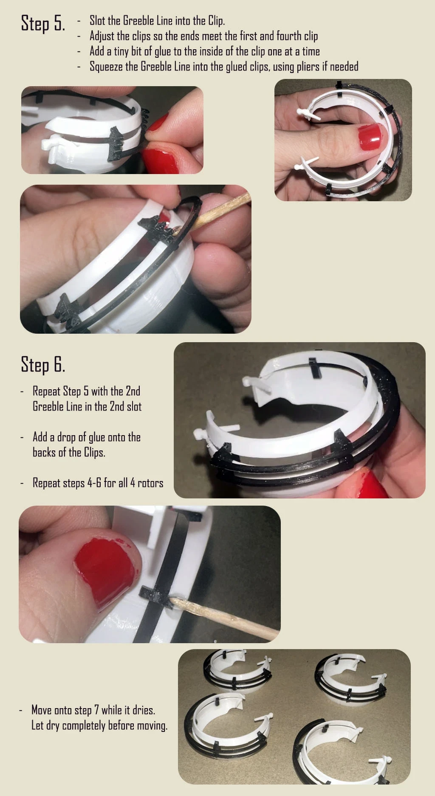

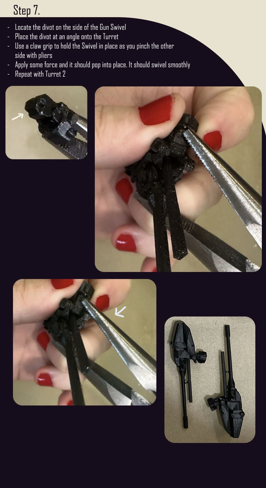 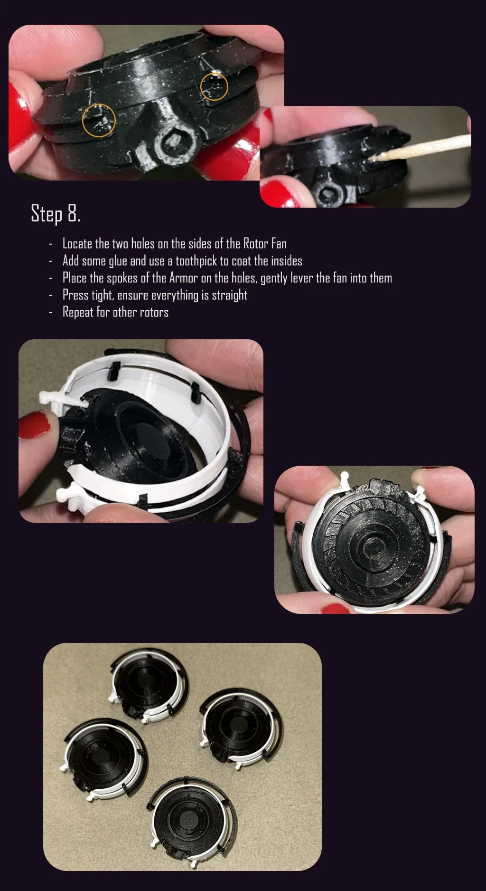

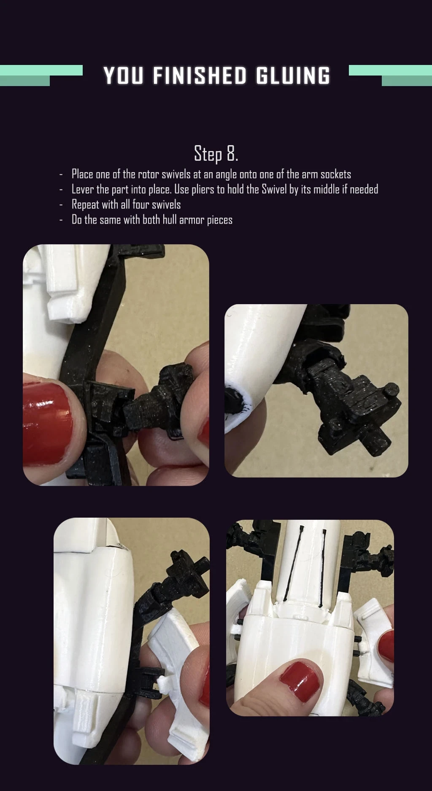 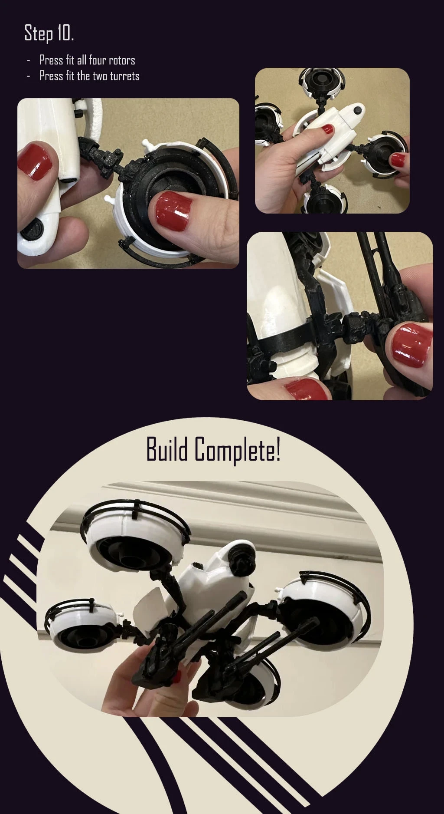
