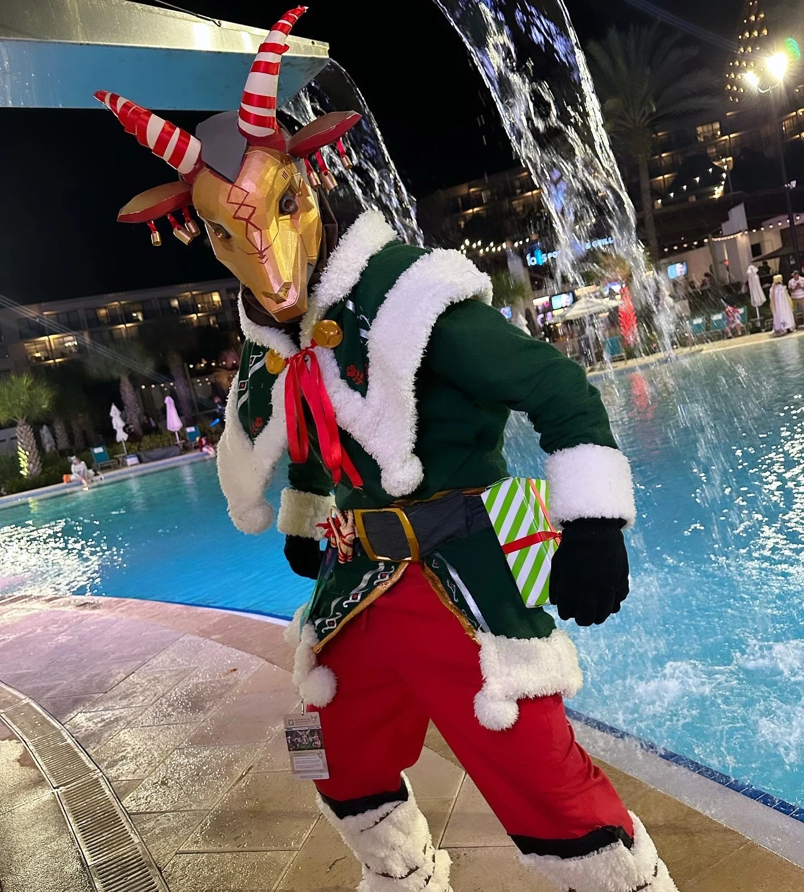
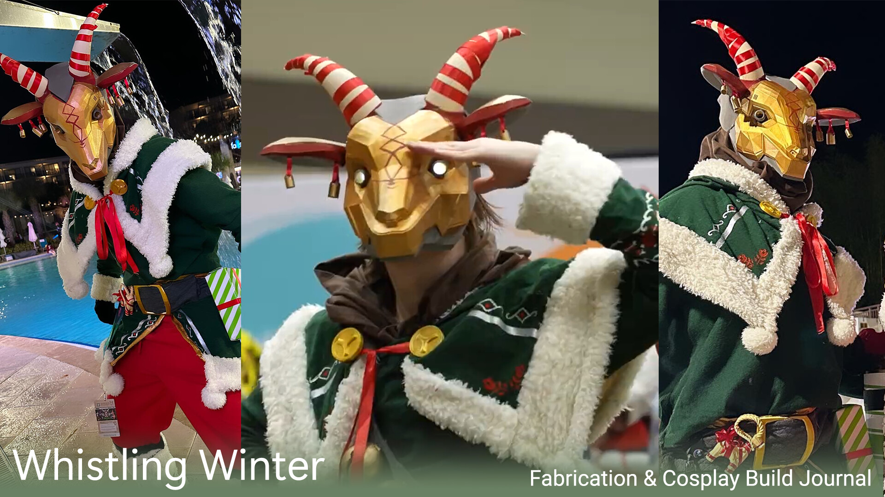
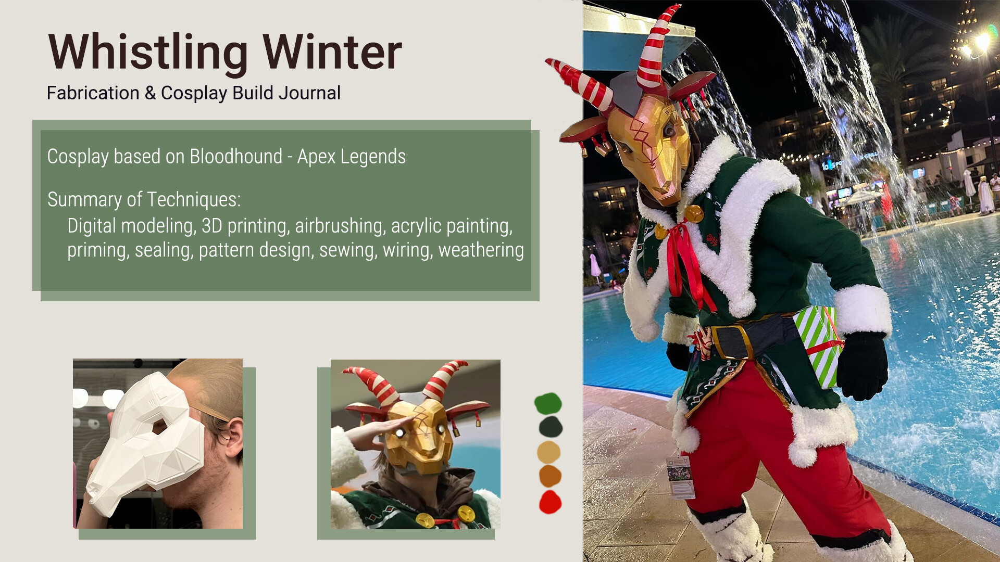
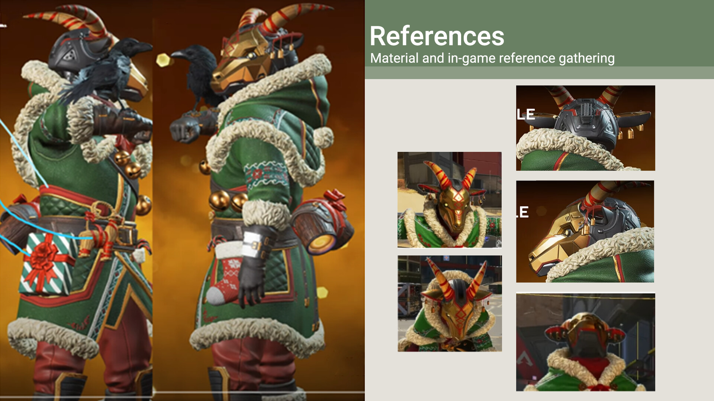
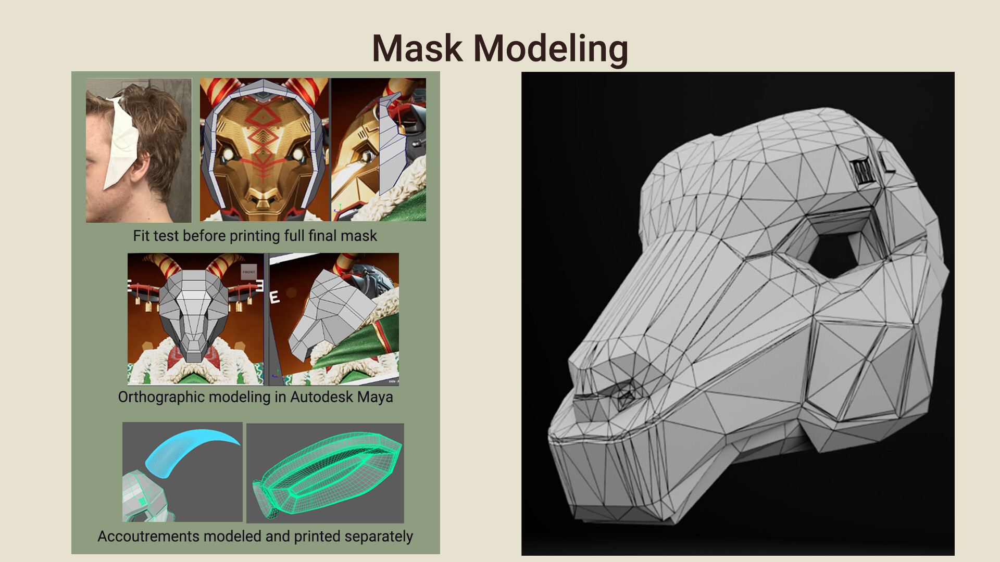
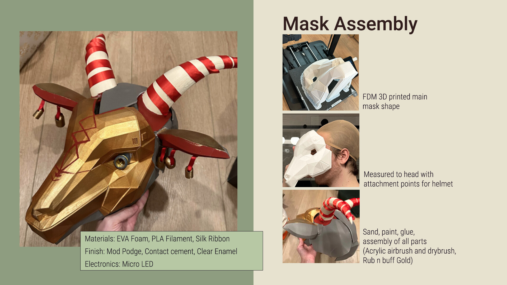
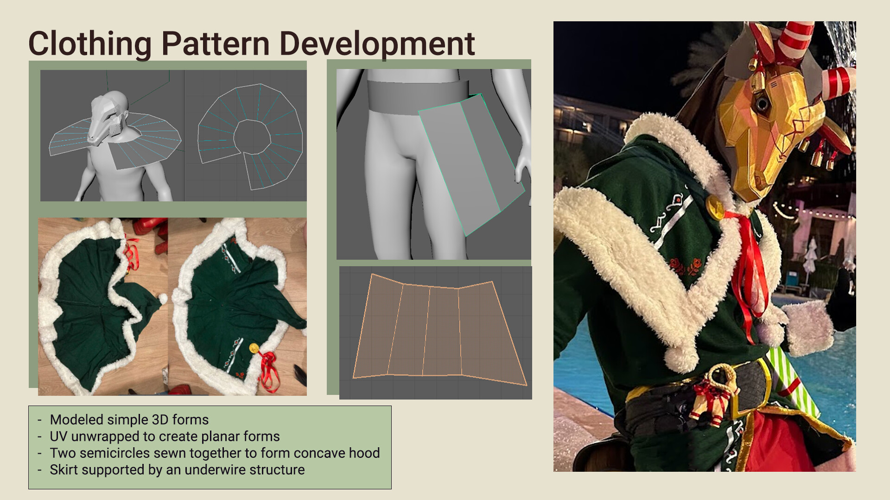
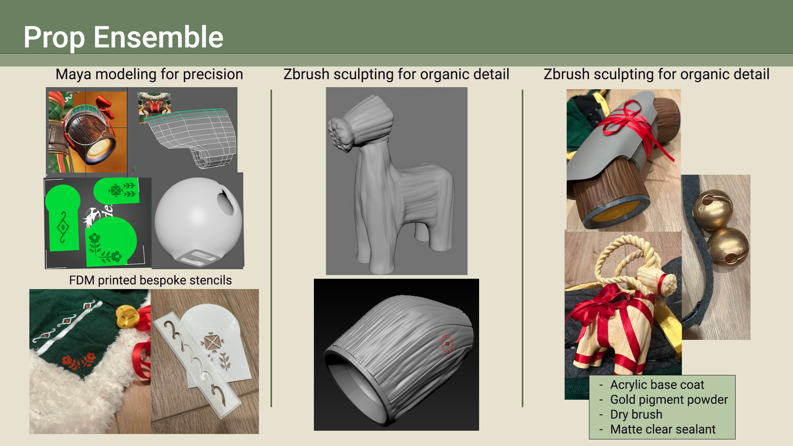
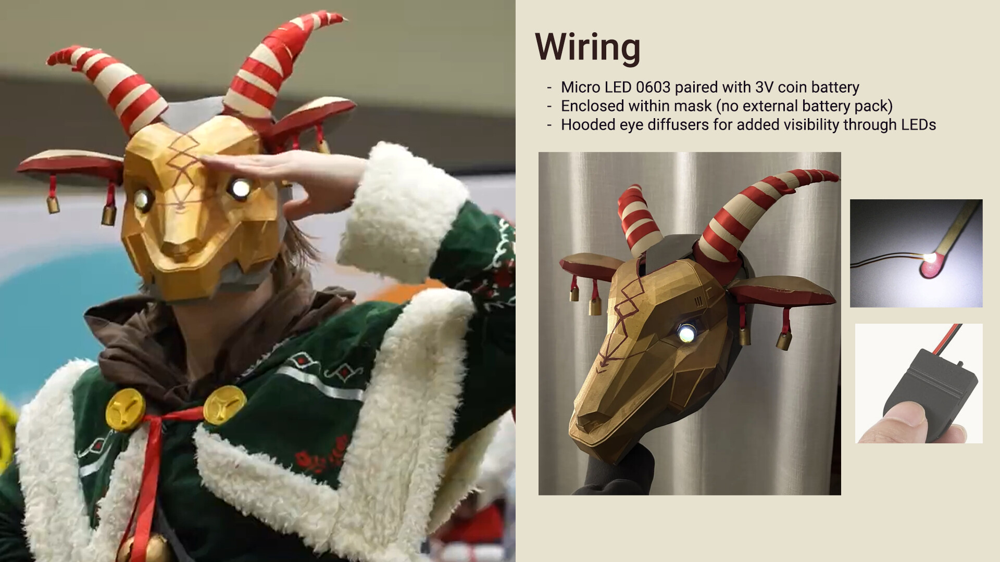

Bringing Bloodhound's festive "Whistling Winter" skin from Apex Legends into the real world required a mixed-media approach, blending digital design techniques with traditional crafting, sewing, and electronics.

By UV unwrapping my 3D clothing models, I was able to use them as custom templates to cut and sew the fabric garments and engineer the skirt's underwire support structure.

My primary goal for this build was to achieve high in-game accuracy while ensuring the costume remained comfortable, wearable, and structurally sound. The project began digitally in Autodesk Maya and ZBrush, where I modeled the mask, prop ensemble, and base forms for the clothing. At the time of building, the game skin hadn't been released, so I had to model everything from scratch using only leaked gameplay videos as reference.

The physical fabrication combines FDM 3D printing for the rigid pieces with EVA foam, custom bespoke stenciling, and layered painting techniques (including airbrushing and dry brushing) to create organic textures true to the game.

For the final touch, I wired micro LEDs with 3D printed diffusers directly into the mask, achieving their signature glowing eyes while maintaining visibility.
