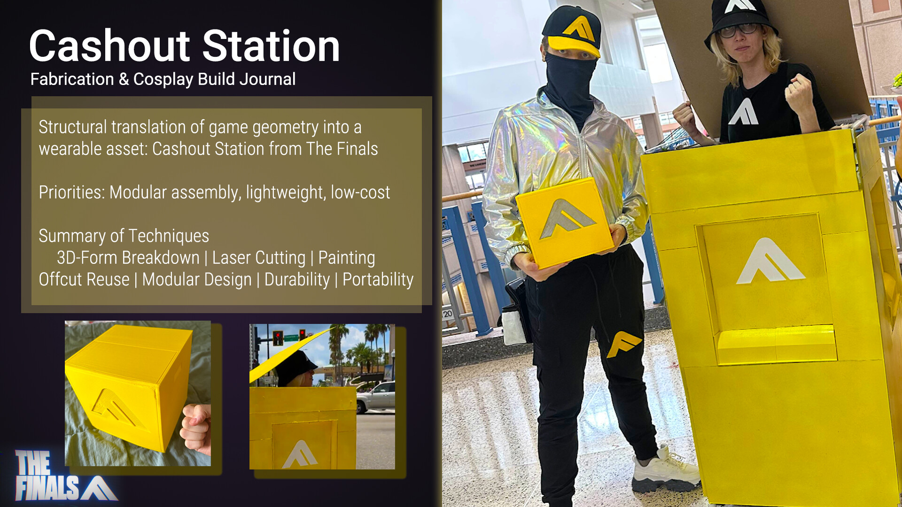
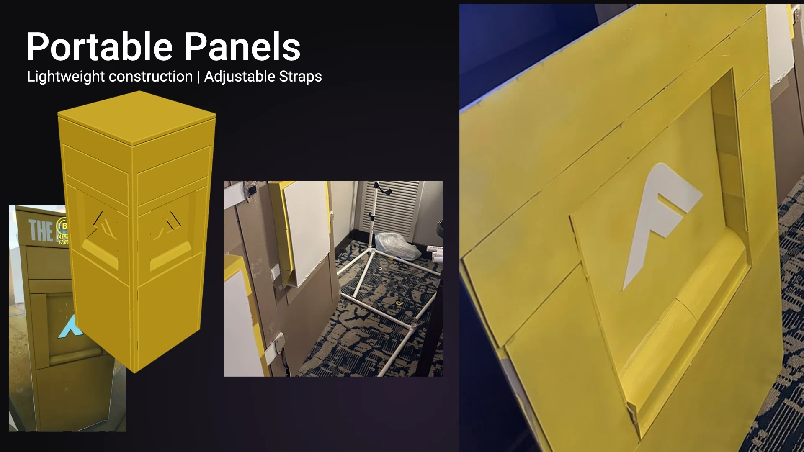
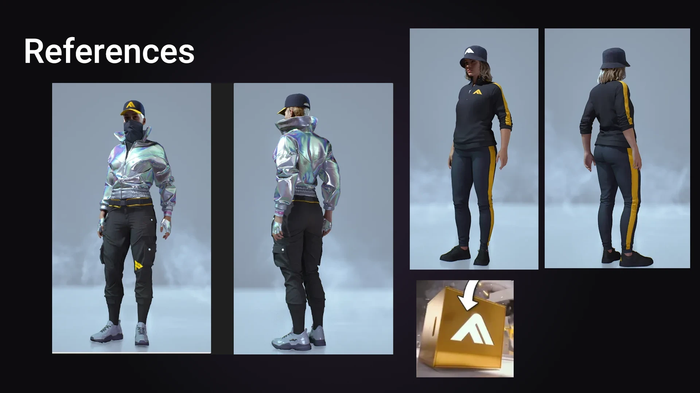

<!-- Dante: this write-up is a placeholder built from your ArtStation slides. Replace it with the real story: what it weighs, how it packs, what it cost, how long it took. -->

A life-size recreation of the Cashout Station from *The Finals*. The brief I set myself: it had to come apart into pieces one person can carry, weigh as little as possible, and cost as little as possible, without reading as a lightweight prop in photos.

