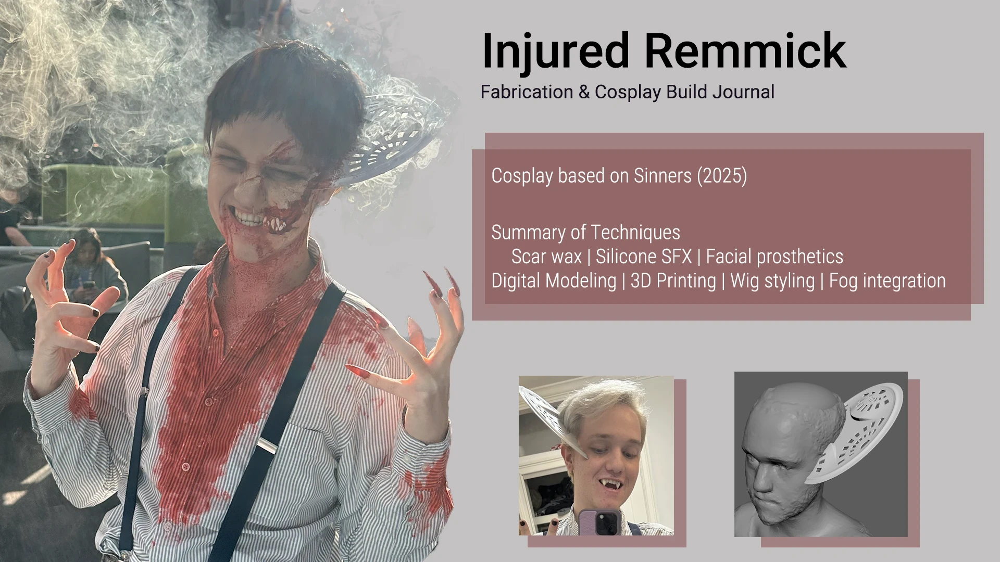
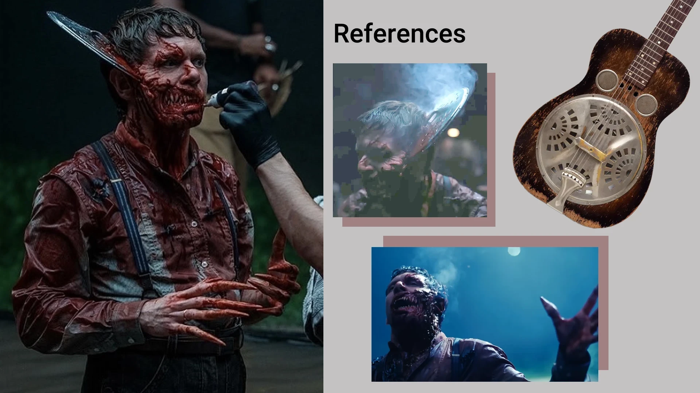
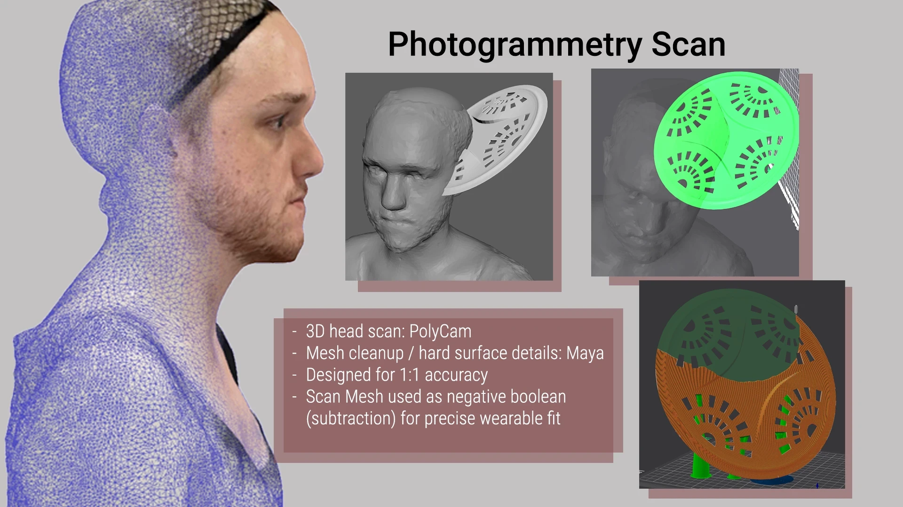
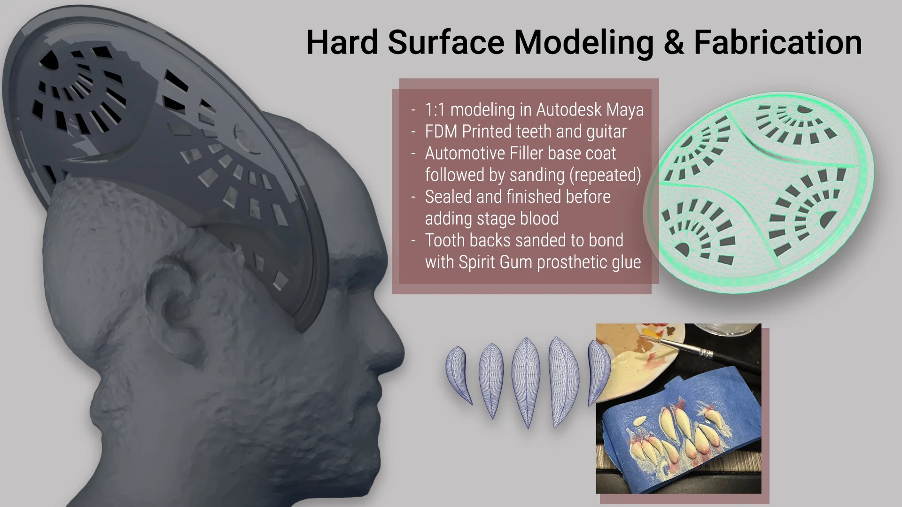
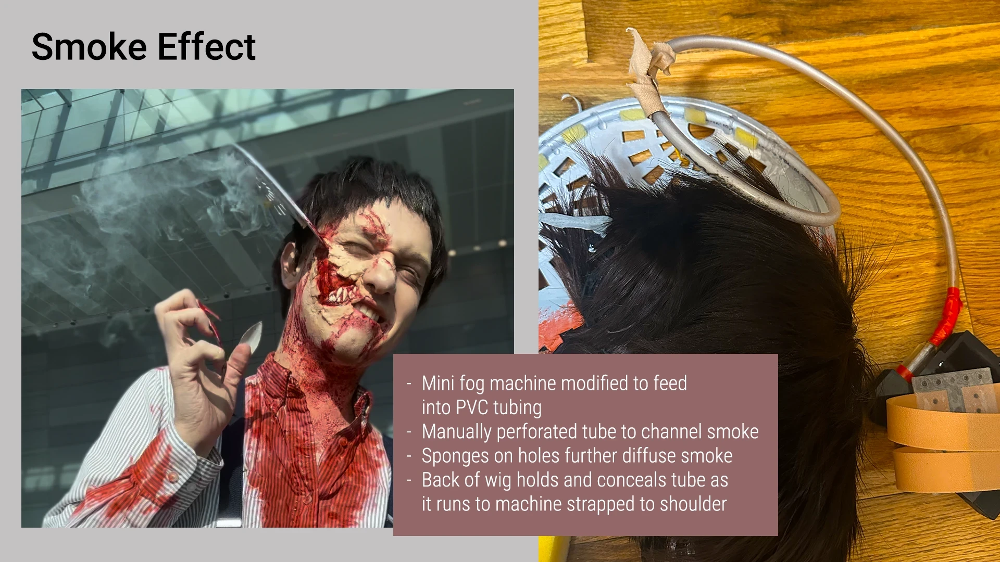
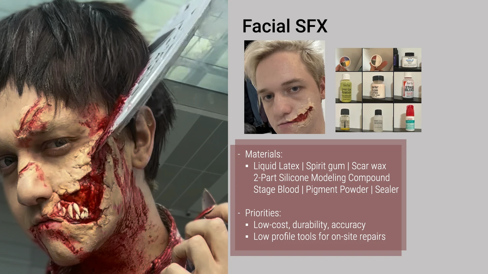
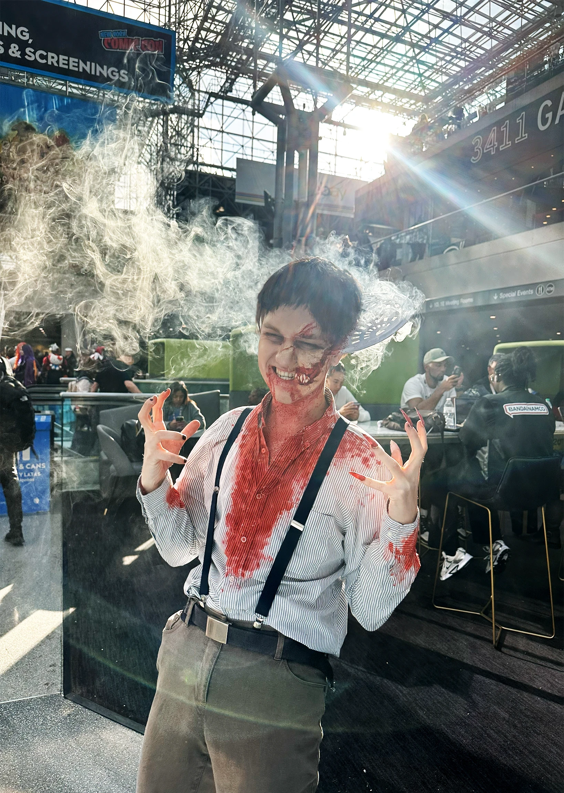

<!-- Dante: expand with how the fog rig works, what's printed vs. sewn, and the finishing steps. -->

Costume of Remmick, the main villain from the film *Sinners*. The build combined digital modeling and 3D printing with practical costume effects, including a fog effect integrated into the costume itself.

