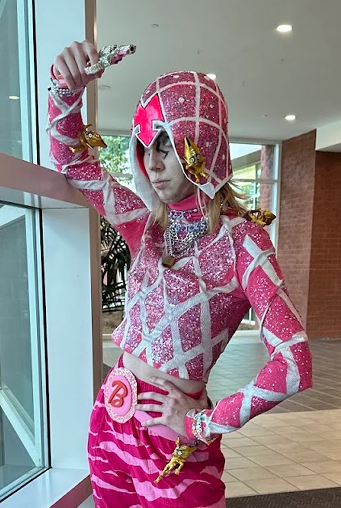
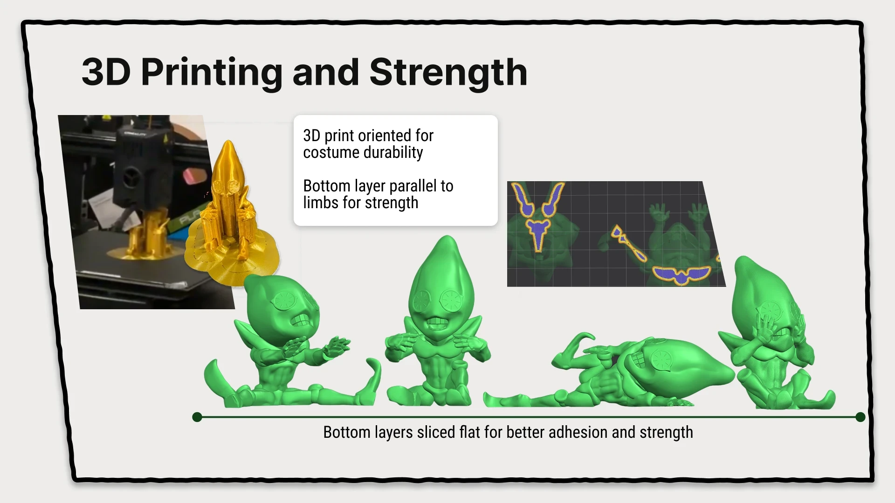
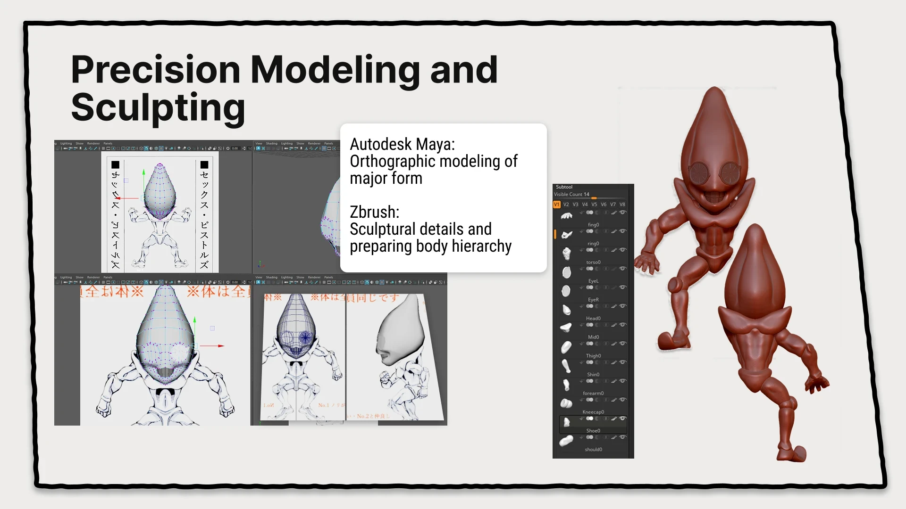
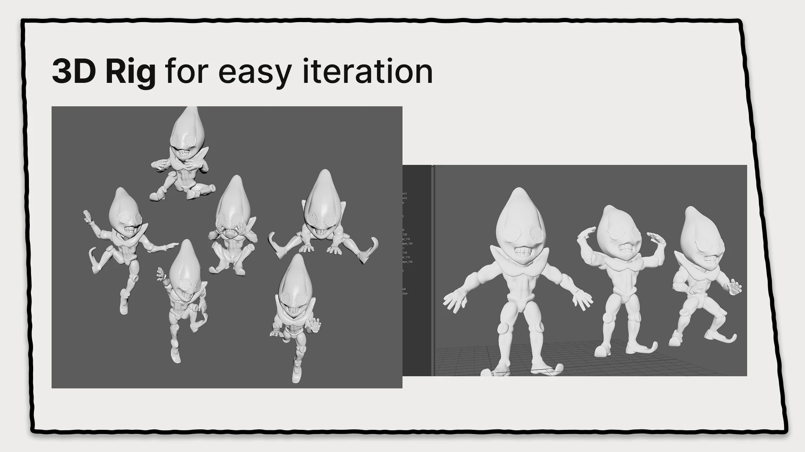
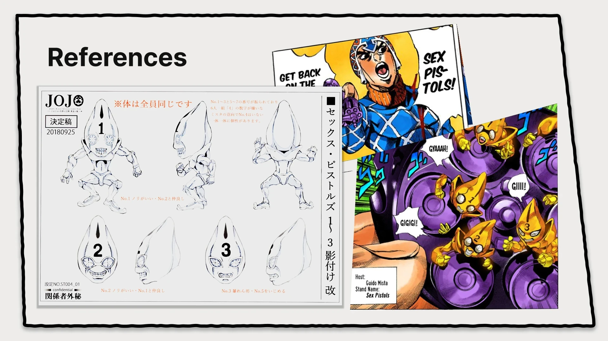
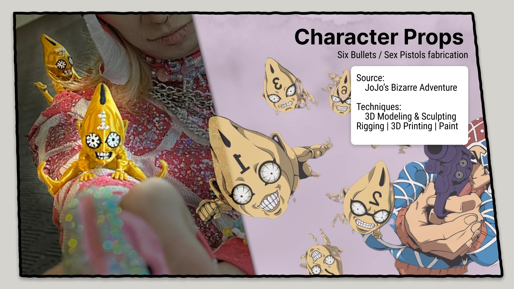
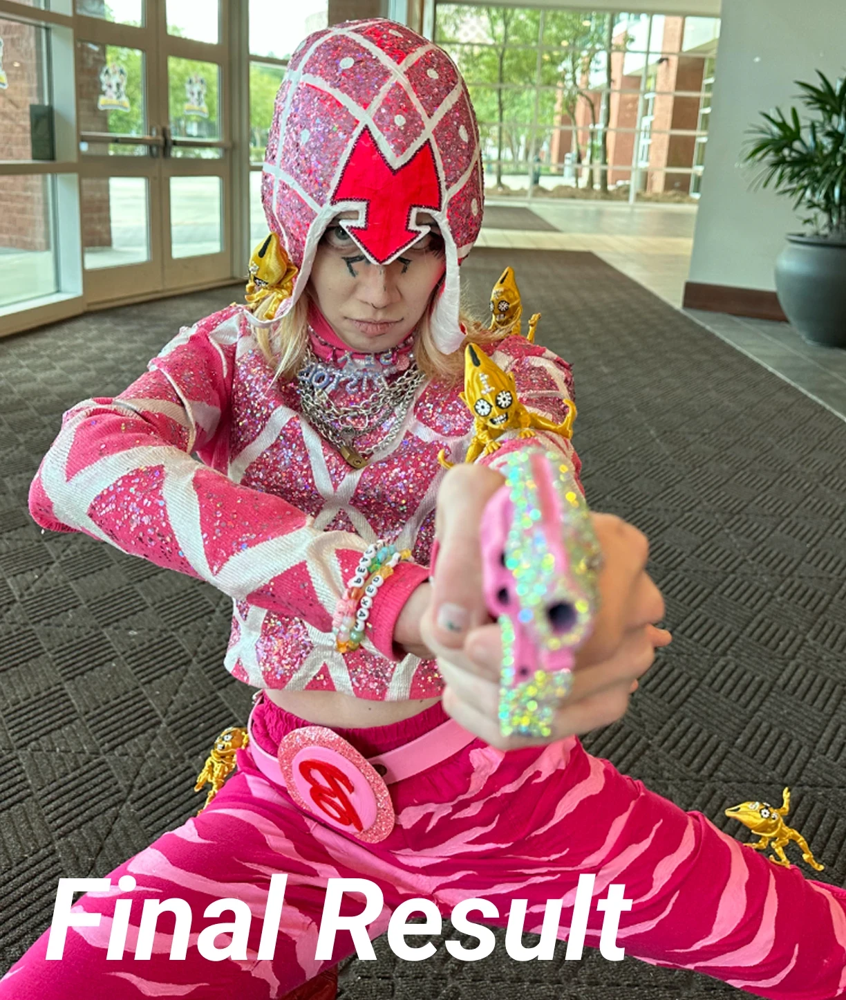

Bringing Guido Mista's Stand to life for a JoJo's Bizarre Adventure cosplay. For this project, I wanted to create highly durable, dynamic props that could survive the wear and tear of a convention floor without sacrificing the iconic style of the manga and anime.

## Modeling and sculpting

Blocked out the major orthographic forms in Autodesk Maya, then moved into ZBrush for sculptural details and to prepare the body hierarchy for mirroring.

## Rigging

Built a custom 3D rig to iterate quickly through the poses unique to each of the bullets.

## 3D printing

Sliced with cosplay durability in mind. I specifically oriented the bottom layers parallel to the limbs to maximize strength and bed adhesion.

## Finishing

Printed, assembled, and painted to match their on-screen and manga appearances before integrating them into the final costume.

