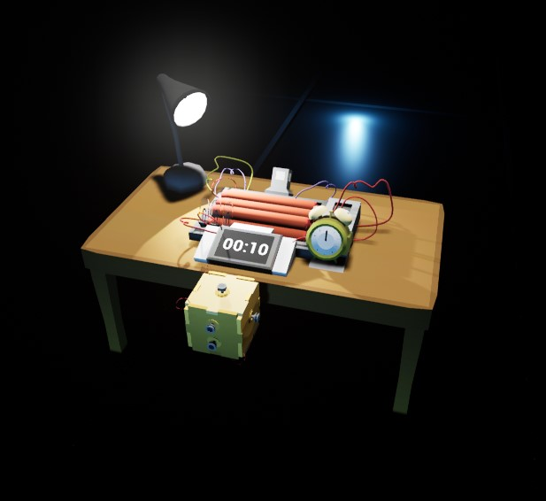
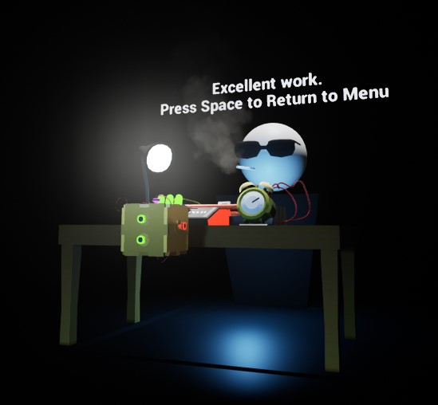
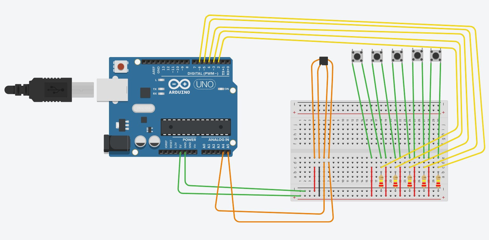
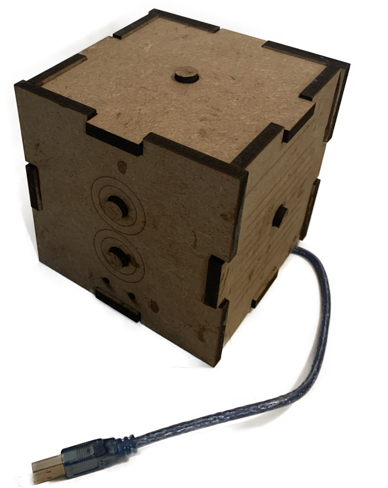
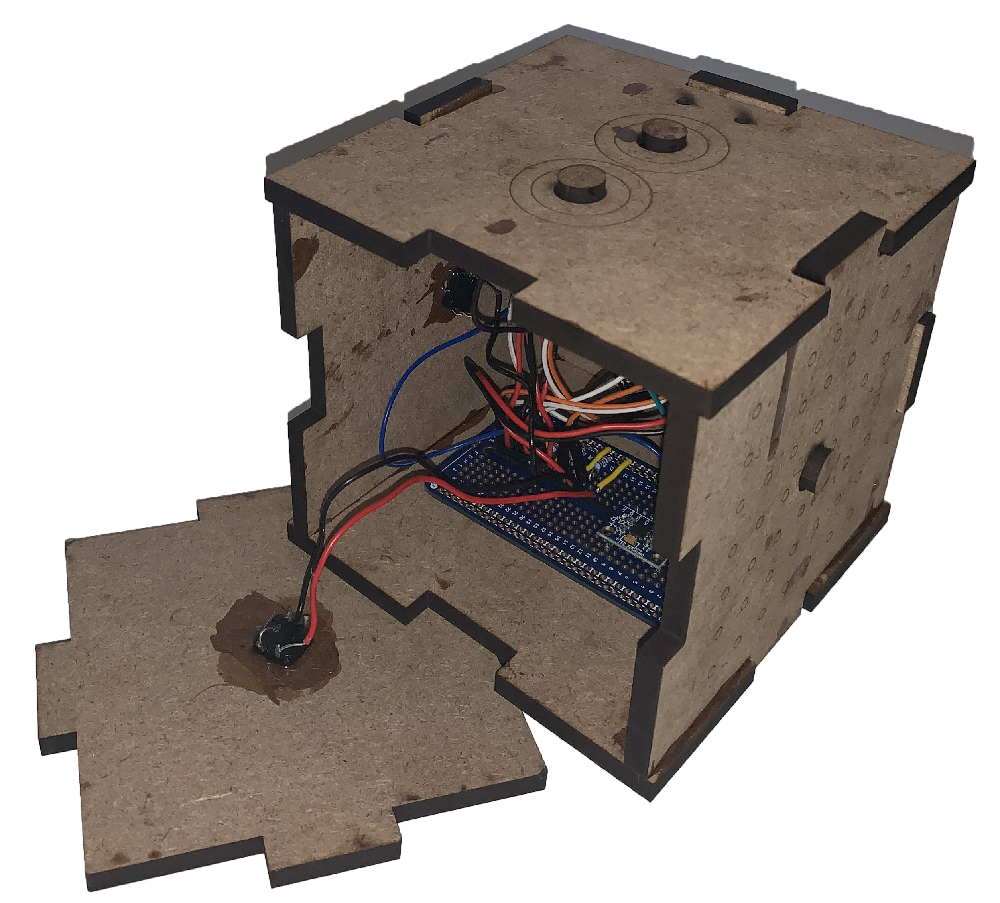
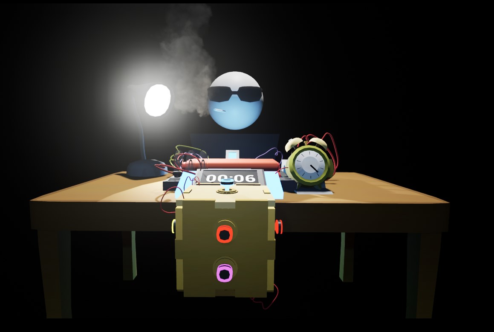

@youtube p9EV14EO7Zg

## Recognition

At SCAD's Entelechy awards, the annual ceremony celebrating the accomplishments of the school of Digital Media, Diffuse AR was chosen to win Best Creative Technology.

## Race against time

The clock is ticking. Press the correct color on the box to defuse the bomb in time.

This virtual experience was created with Unreal Engine 4.27. The UE4Duino plugin was implemented to communicate with the Arduino components, and the gameplay loop is coded in Blueprints to read the various controller inputs.

 

## Physical interface

The physical controller was designed with wooden, laser-cut components. Quarter-inch MDF was used to create a sturdy container for the buttons and gyroscope components.

The connections are built on an Arduino Uno, an MPU6050 gyroscope, and several pushbuttons. All elements are soldered to a protoboard secured to the back of the box. The USB-A cord travels out of the bottom and into the computer running the game.

- MPU6050 gyroscope
- Arduino Uno
- 220 kΩ resistors
- Momentary switches

 

## Virtual interface

Within Unreal Engine, the controller spins in relation to the real-world box, driven by the gyroscope component. The buttons match each virtual button attached to each side of the box. The button and gyroscope data are coded in Arduino to interface with Unreal Engine. The result is a controllable box that follows the X-axis rotation of the physical controller.

## Assets

All of the assets for Diffuse AR were created in Autodesk Maya. Once imported into Unreal, each element was placed and lit for a mysterious, reflex-based VR game.

The wire-covered bomb sits on the empty table. In front of the player is a digital timer that counts down to the next explosion; only inputting the correct color before time runs out will stop it. Next to this is an analog clock whose hand spins in real time, furthering the pressure to succeed.

## Mister X

Out of the shadows comes your employer: Mister X. This shady figure guides the player through their tasks and gives them tips on how to interface with the game.

This simple character acts as all the needed UI and tutorial for a tight, replayable game. His oversight helps the player know the result of each button press, and his colorful commentary tells you just how well you've succeeded or how badly you've failed.
