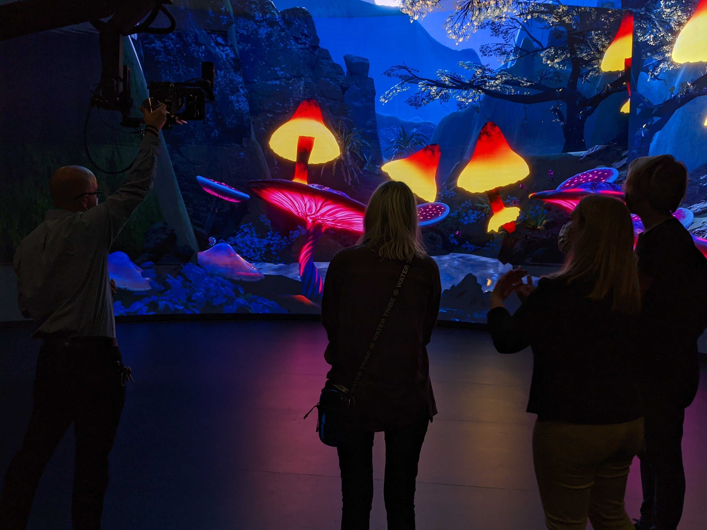

@youtube RGIRSylJ6Wk

## XR Stage

SCAD's XR Stage is a massive LED wall used to project real-time environments into the background of scenes. The volume simulates the lighting and reflections of the game-engine background to make footage more realistic.

## Process

I was on the team working on the virtual background. We created the environment and set up the file with the proper plugins so it could be viewed on the XR volume. Unreal Engine was used to set-dress and light the scene.

## Development

Luminance was a collaboration between VSFX, Immersive Reality, and Film students. Regular meetings and communication were necessary to remain punctual and organized. The relative newness of the technology meant that checkpoints had to be met precisely to ensure file compatibility and quality.

