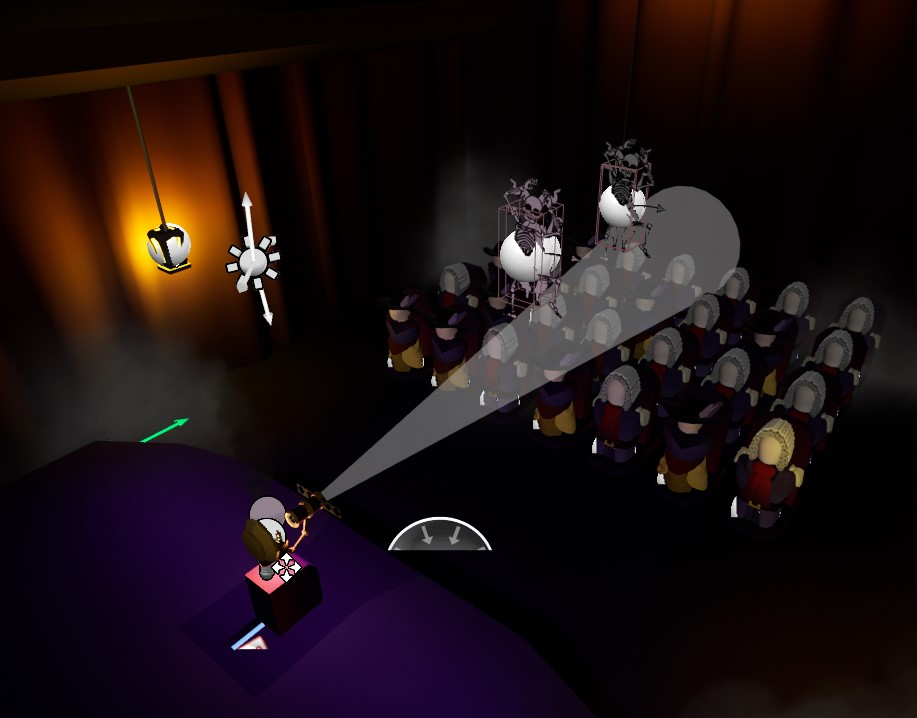
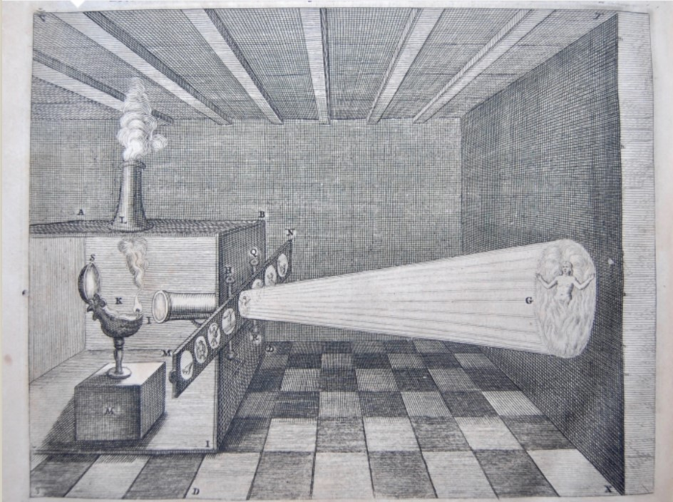

@youtube GqmA1gS3GEE

 

## History

This project is based on the 17th-century phenomenon of the phantasmagoria, specifically Kircher's invention of the magic lantern. Really just a precursor to the projector, the magic lantern was eventually used in performative revelations of the spirit world and its connection to Earth. Traveling performers called Wizards would flood the audience with sensory input, like smoke and low-frequency music, convincing them that the demons brought from the séance were truly otherworldly.

This project presents the lantern's claims as though they were true, giving the player the experience of one of these 17th-century Wizards in virtual reality.

## Animation

Because the original magic lantern projected its demons onto a flat surface, the animations of the demons are similarly two-dimensional. The hand-drawn textures, once assigned a mesh and skeleton, were animated to dance and flow across the screen as they are revealed.
