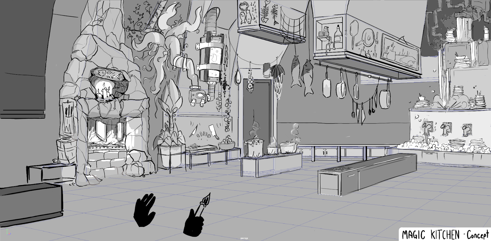
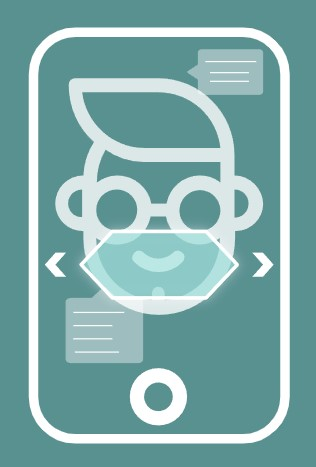

@youtube 79qdY3Um96U

## AR for a purpose

MASQ was ideated in 2020, in the midst of the pandemic. The purpose of this project is to provide a simple visualization tool for face-mask information.

The app serves to connect users to a consolidated source to help decide which mask is right for them. The AR feature projects the featured masks directly onto the user's face in real time, providing an interactive live preview of their safety options.

## Art and design

MASQ's design profile is both simplistic and efficient. With small, abstract meshes, the engine demands of real-time augmented reality are met.

The program combines 3D projection with a 2D user interface. As the image follows the user, they are able to switch materials and shapes live without losing tracking or clarity.

