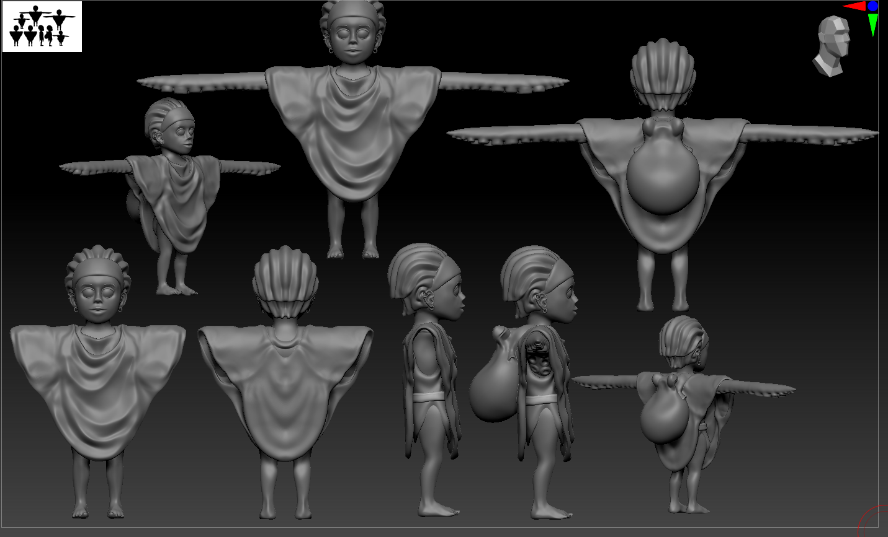
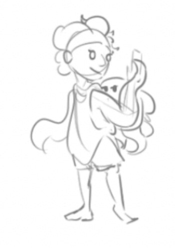
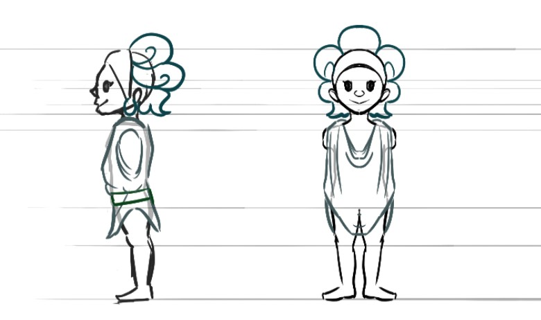
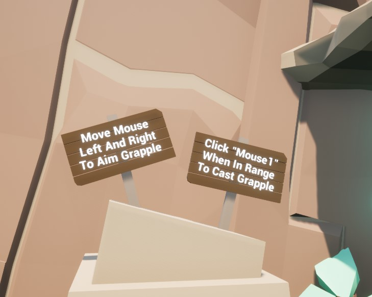

@youtube zYJZCrJWxN0

## Design and process

This project's goal is to create an interactive experience that experiments with multi-character animation. The process started with ideation sketches to develop the style and shape of the main, playable character.

Character concept art is conceived and designed with a specific animation specification in mind. The combination of two characters transitioning into jump and swing states presents a variety of unique challenges.

 

## Rig and animation

Ruka's tentacles and animation-based movement are a combination of real-time physics and baked skeletal animations. Animating both characters together creates a complex rig, able to combine different animations in order to switch to the desired states. The characters were rigged, weight painted, and animated in Autodesk Maya.

## Gameplay

Ruka is a physics-based platformer that relies on precise mouse movements paired with timed jump prediction. With the linear design of the cliff face, gravity is the main obstacle a player will encounter. Progress can be made by moving upwards, and is lost by falling down. Reaching the summit spells victory for the player and their sheep.

## Environmental hazard

The seagulls of Ruka act as the enemy of the game. Their presence is made known as each bird flies away in a flurry of feathers. Casting the grapple towards a seagull's perch will cancel the grapple and leave you plummeting downward.
