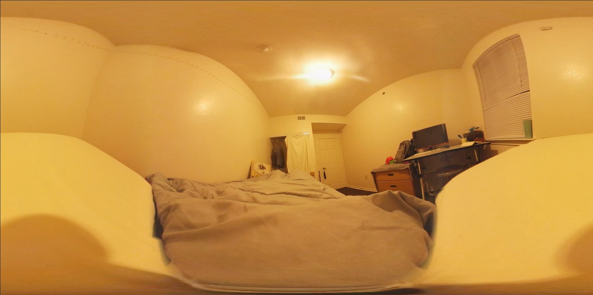

@youtube bF3z0etjrbo

## Process

The background footage for this experience was shot on a Samsung Gear 360. After Effects is used to composite immersive animations over the equirectangular 360 footage. The sleep paralysis demon is hand-rotoscoped in After Effects. The experience was then rendered as a 360 video, compatible with video players and VR headsets alike.

## Narrative

Sleep Paralysis VR is based on a true account of suffering from sleep paralysis. Past experiences of the condition are represented using animations made in After Effects. The illusion-breaking moment at the end of the experience also reflects that personal account: the sounds of their household would often break them out of the paralysis.

## Watch it

Open the YouTube link on your phone or VR headset. It plays on any VR device that can access YouTube, including Google Cardboard, and with a mouse in a browser.
