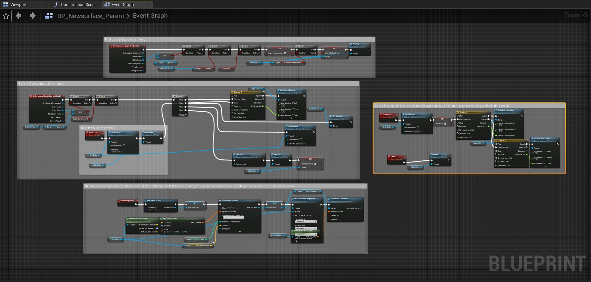

@youtube kFrhLcFcnjQ

## History

Stroke of Magic began development at the beginning of 2022 during a senior studio class.

Once it was decided that this game would be built for Quest, the pipeline underwent heavy consideration to be sure of the possibility of the game's scope. Building for mobile using Unreal Engine was a new experience for everyone in the team, but with careful planning and use of Agile methodology, the development process was able to remain smooth and steady.

## Recognition

At SCAD's Entelechy awards, the annual ceremony celebrating the accomplishments of the school of Digital Media, Stroke of Magic was chosen to win the title of Best 3D Game. The game is free to download and play: install SideQuest, then load the app onto any Quest 2 headset.

@youtube xrO0GBpSAx0

## Contributions

### Conduit painting

The conduit is a type of magic that can be channeled by the paintbrush in Stroke of Magic. I developed and created its functionality as tech lead: the Blueprints that make up the puzzles, a dynamic, VR-capable paint-trail particle, and the interactions needed to complete the game's level sequence.

The Blueprints create an instance-able, reworkable parent for replication, complete with efficient and clean timeline animations.

### Puzzle and level design

Using the conduit as a base for puzzle design yielded unique challenges for players in VR. Animated puzzles, such as this mortar-and-pestle, incorporate a drawable surface as part of the solution. These interactable elements are seen throughout the environment, promoting a unified, modular immersion for any user.

### VR interactivity

To maintain immersion, environmental interactions and animations appear throughout each level. Several VR interactions were created and designed to give puzzles an extra element of fantasy as well as clarity. This includes the conduit puzzle's detachable power source, which must be retrieved and replaced before the line can be drawn again.

### Animation

Animations are implemented as gameplay elements, environmental interactions, and mechanical movements throughout the level. To meet the requirements of VR development, animation must be smooth and efficient. Timelines were heavily utilized to avoid instancing animation Blueprints, saving processing power. Combining environmental feedback with animation creates a rewarding puzzle-solving experience.

## Pipeline

This project heavily utilized standard Immersive Reality pipeline workflows. The Agile methodology was employed for the entirety of Stroke of Magic, with development split into scrum sprints. To ensure correct game-engine communication throughout the team, Perforce was used as version control for the project.
