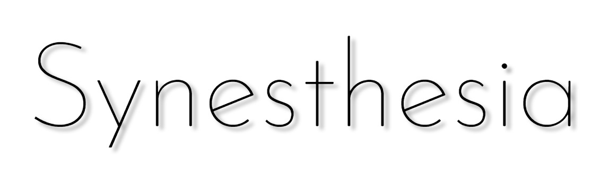

@youtube GIr2cvVco58

## Process

The dancing shapes were animated by hand in Quill, a VR animation tool. The ribbons move across the screen, overlaid onto the 360 footage of the New Zealand Symphony Orchestra. Each journey of each ribbon represents a real-world hand motion, captured using VR controllers and repeated to create mesmerizing patterns.

## Watch it

Open the YouTube link on your phone or VR headset. It plays on any VR device that can access YouTube, including Google Cardboard.
