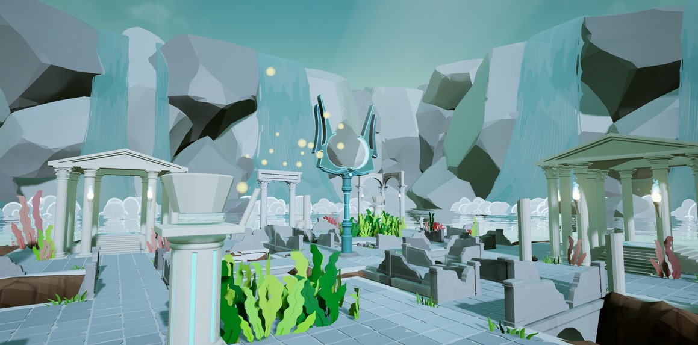

@youtube dhWQd41XbjI

## History

The concept for Tridentia was pitched in the spring of 2021. My love of asymmetrical VR provided the perfect opportunity to develop an experience of my own. The project underwent development until the end of the summer of 2021.

## Recognition

At SCAD's Entelechy awards, the annual ceremony celebrating the accomplishments of the school of Digital Media, Tridentia was chosen to win Best Interactive VR. After a showcase at which all of the submitted projects were judged, Tridentia was chosen to win Best of Show.

## Contributions

### Producer

I led the team in both stages of development. As producer, I was responsible for scoping the project, delegating tasks, organizing the team, and communicating between departments.

### Design leadership

Because of the relative complexity that comes with developing an asymmetrical VR game, the ideation for Tridentia is extensive. I designed the gameplay loop, and as such oversaw every checkpoint of the development pipeline in order to maintain the project's vision. The video below is an in-depth gameplay overview.

@youtube LsI-_4yE5vg

### Animation

With two characters of vastly different sizes, there was a wealth of animation necessary to create the world. The Hero and the god's traps react to one another, changing the world to give Poseidon a hint of her hiding place. The hero has several abilities, all of which were animated in Maya and imported into Unreal Engine.

### Asymmetrical gameplay

Designing gameplay interactions between a tethered VR headset and a third-person PC character is an extreme challenge. In order to up the intensity of the PVP, some choices (like giving neither player a way to directly attack one another) allow for emergent, exciting gameplay.
